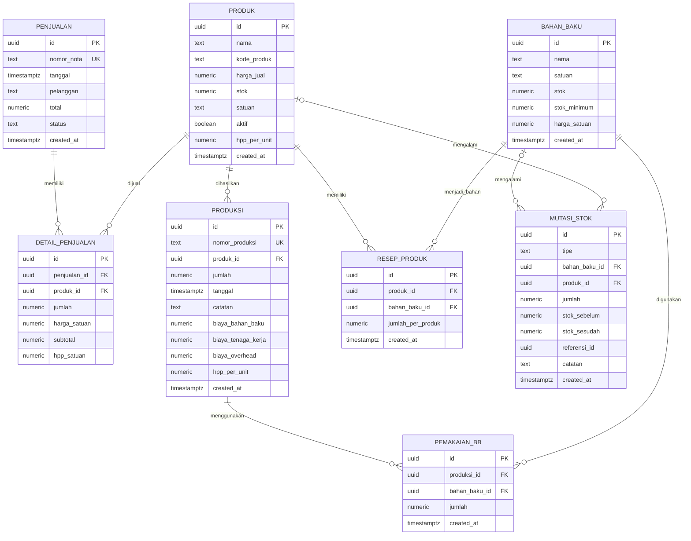

Sistem Akuntansi Toko BakeLY

[Website: https://rahmaliakusumadewi0-pixel.github.io/Sistem-Akuntansi-Toko-BakeLY/](https://rahmaliakusumadewi0-pixel.github.io/Sistem-Akuntansi-Toko-BakeLY/)

Aplikasi berbasis web untuk membantu pengelolaan penjualan, persediaan bahan baku, produksi, dan pencatatan pemakaian bahan baku pada usaha bakery.

1. Deskripsi Sistem

Sistem Akuntansi Toko BakeLY merupakan aplikasi yang dirancang untuk mendukung pencatatan dan pengelolaan aktivitas operasional usaha bakery secara terstruktur. Sistem ini mencakup pengelolaan bahan baku, barang jadi, pemakaian bahan baku, produksi, dan penjualan. Dalam usaha bakery, kegiatan produksi membutuhkan bahan baku dengan jenis dan jumlah yang berbeda. Selain itu, jumlah produk yang dihasilkan dan penjualan perlu dicatat agar pemilik usaha dapat memantau persediaan serta aktivitas operasional dengan lebih mudah.
Aplikasi ini dikembangkan untuk membantu mengintegrasikan pencatatan persediaan, produksi, dan penjualan dalam satu sistem. Supabase digunakan sebagai backend dan PostgreSQL sebagai basis data untuk mendukung penyimpanan serta pengelolaan data aplikasi.

2. Tujuan Pengembangan

- Membantu pengelolaan data bahan baku dan persediaannya.
- Mempermudah pencatatan hasil produksi bakery.
- Mendukung pencatatan pemakaian bahan baku dalam proses produksi.
- Membantu pengelolaan data penjualan dan transaksi.
- Mempermudah pemantauan ketersediaan bahan baku dan barang jadi.
- Menyediakan informasi operasional untuk mendukung pengambilan keputusan usaha.

3. Fitur Utama

| Fitur | Deskripsi |
|---|---|
| Dashboard | Menampilkan ringkasan informasi penjualan, barang jadi, stok bahan baku, dan aktivitas produksi. |
| Bahan Baku | Mengelola data bahan baku, kode, nama, satuan, harga, dan jumlah persediaan. |
| Barang Jadi | Mengelola data produk bakery yang dihasilkan dan informasi persediaannya. |
| Produksi | Mencatat kegiatan produksi dan jumlah produk yang dihasilkan. |
| Pemakaian Bahan Baku | Mencatat bahan baku yang digunakan dalam proses produksi. |
| Penjualan | Mencatat transaksi penjualan produk bakery dan informasi terkait transaksi. |

4. Sistem Akuntansi pada Usaha Bakery

Sistem Akuntansi Toko BakeLY menerapkan konsep pencatatan akuntansi pada aktivitas persediaan, produksi, dan penjualan usaha bakery.

Pencatatan dilakukan dengan memperhatikan tiga kelompok utama berikut.

| Komponen | Penjelasan |
|---|---|
| Persediaan Bahan Baku | Mencatat bahan yang digunakan dalam proses produksi, seperti tepung terigu, gula, mentega, telur, dan ragi. |
| Persediaan Barang Jadi | Mencatat produk bakery yang telah selesai diproduksi dan tersedia untuk dijual. |
| Penjualan | Mencatat transaksi penjualan produk sebagai bagian dari aktivitas pendapatan usaha. |

Dalam kegiatan produksi, bahan baku digunakan untuk menghasilkan barang jadi. Selanjutnya, barang jadi yang tersedia dapat dijual kepada pelanggan. Pencatatan tersebut membantu pemilik usaha mengetahui pergerakan persediaan dan mengawasi aktivitas operasional bakery. Perhitungan harga pokok produksi dan laba memerlukan data biaya yang memadai, seperti biaya bahan baku, tenaga kerja langsung, dan overhead produksi.

5. Alur Sistem

- Pengguna membuka Dashboard untuk melihat ringkasan informasi operasional bakery.
- Pengguna mengelola data bahan baku melalui menu Bahan Baku.
- Pengguna mengelola produk bakery melalui menu Barang Jadi.
- Pengguna mencatat kegiatan produksi dan jumlah produk yang dihasilkan.
- Pengguna mencatat pemakaian bahan baku yang digunakan dalam proses produksi.
- Pengguna mencatat transaksi penjualan produk bakery.
- Data yang tersimpan digunakan untuk membantu pemantauan persediaan, produksi, dan penjualan.

6. Entity Relationship Diagram (ERD)

Entity Relationship Diagram (ERD) menggambarkan struktur basis data dan hubungan antartabel dalam Sistem Akuntansi Toko BakeLY. Database menggunakan PostgreSQL melalui Supabase dan terdiri atas delapan tabel utama, yaitu `bahan_baku`, `produk`, `penjualan`, `detail_penjualan`, `produksi`, `pemakaian_bb`, `mutasi_stok`, dan `resep_produk`.

### Deskripsi Tabel Database

| Nama Tabel | Fungsi |
|---|---|
| `bahan_baku` | Menyimpan data bahan baku, satuan, stok, batas stok minimum, dan harga satuan. |
| `produk` | Menyimpan data produk bakery, kode produk, harga jual, stok, status aktif, dan HPP per unit. |
| `penjualan` | Menyimpan informasi transaksi penjualan, nomor nota, tanggal, pelanggan, total, dan status transaksi. |
| `detail_penjualan` | Menyimpan rincian produk yang terjual, jumlah, harga satuan, subtotal, dan HPP satuan. |
| `produksi` | Mencatat kegiatan produksi, jumlah produk, tanggal, serta komponen biaya produksi. |
| `pemakaian_bb` | Mencatat jumlah bahan baku yang digunakan dalam suatu kegiatan produksi. |
| `resep_produk` | Menyimpan komposisi bahan baku dan jumlah bahan yang diperlukan untuk setiap produk. |
| `mutasi_stok` | Mencatat perubahan persediaan bahan baku atau produk, termasuk jenis mutasi serta stok sebelum dan sesudah perubahan. |

### Relasi Antartabel

- `penjualan` terhubung dengan `detail_penjualan` melalui `penjualan_id`. Satu transaksi dapat memiliki beberapa rincian produk.
- `produk` terhubung dengan `detail_penjualan` melalui `produk_id` untuk menunjukkan produk yang dijual.
- `produk` terhubung dengan `produksi` melalui `produk_id` untuk mencatat kegiatan produksi setiap produk.
- `produksi` terhubung dengan `pemakaian_bb` melalui `produksi_id` untuk mencatat bahan baku yang digunakan dalam produksi.
- `bahan_baku` terhubung dengan `pemakaian_bb` melalui `bahan_baku_id` untuk mengidentifikasi bahan yang digunakan.
- `produk` dan `bahan_baku` terhubung melalui `resep_produk` untuk menggambarkan komposisi bahan baku setiap produk.
- `mutasi_stok` dapat mencatat perubahan stok bahan baku maupun produk melalui kolom `bahan_baku_id` dan `produk_id`.
- Kolom `referensi_id` pada `mutasi_stok` menyimpan identitas referensi transaksi, tetapi tidak didefinisikan sebagai foreign key dalam skema yang diberikan.

Keterangan:
- `PK` (*Primary Key*) adalah kunci utama untuk mengidentifikasi setiap baris data.
- `FK` (*Foreign Key*) adalah kunci yang menghubungkan suatu tabel dengan tabel lain.
- `UK` (*Unique Key*) menunjukkan kolom dengan nilai yang tidak boleh duplikat.
- Relasi pada diagram menunjukkan hubungan berdasarkan foreign key yang didefinisikan dalam skema database.
7. Teknologi Pengembangan

| Komponen | Teknologi | Fungsi |
|---|---|---|
| Frontend | HTML, CSS, dan JavaScript | Membangun antarmuka dan fungsi aplikasi web. |
| Backend | Supabase | Menyediakan layanan backend dan akses ke basis data. |
| Database | PostgreSQL melalui Supabase | Menyimpan dan mengelola data aplikasi. |
| Visualisasi Data | Chart.js | Menampilkan grafik untuk membantu pemantauan informasi pada Dashboard. |
| Hosting | GitHub Pages | Menyediakan akses ke website aplikasi. |

8. Manfaat Sistem

- Membantu pencatatan persediaan bahan baku secara terstruktur.
- Mempermudah pemantauan ketersediaan bahan baku dan barang jadi.
- Mendukung pencatatan pemakaian bahan baku untuk produksi.
- Mempermudah pencatatan hasil produksi bakery.
- Membantu pengelolaan transaksi penjualan.
- Menyajikan ringkasan informasi operasional melalui Dashboard.
- Mendukung pengawasan dan evaluasi kegiatan usaha bakery.

9. Integrasi Basis Data

Sistem Akuntansi Toko BakeLY menggunakan Supabase dengan PostgreSQL sebagai basis data untuk menyimpan dan mengelola informasi aplikasi.

Struktur utama basis data terdiri atas tabel `bahan_baku`, `barang_jadi`, `pemakaian_bb`, `produksi`, dan `penjualan`. Setiap tabel memiliki fungsi yang mendukung pencatatan aktivitas operasional usaha bakery.

Integrasi basis data memungkinkan aplikasi mengelola data sesuai dengan fungsi masing-masing menu. Data yang dimasukkan melalui aplikasi disimpan berdasarkan konfigurasi dan struktur basis data yang diterapkan.

10. Penutup

Sistem Akuntansi Toko BakeLY merupakan implementasi konsep akuntansi pada pengelolaan usaha bakery melalui aplikasi berbasis web. Dengan fitur Dashboard, Bahan Baku, Barang Jadi, Produksi, Pemakaian Bahan Baku, dan Penjualan, aplikasi ini dirancang untuk membantu pencatatan aktivitas operasional secara lebih terstruktur.

Integrasi dengan Supabase dan PostgreSQL mendukung pengelolaan data dalam satu sistem sehingga informasi persediaan, produksi, dan penjualan dapat digunakan untuk membantu pemantauan serta evaluasi kegiatan usaha bakery.
